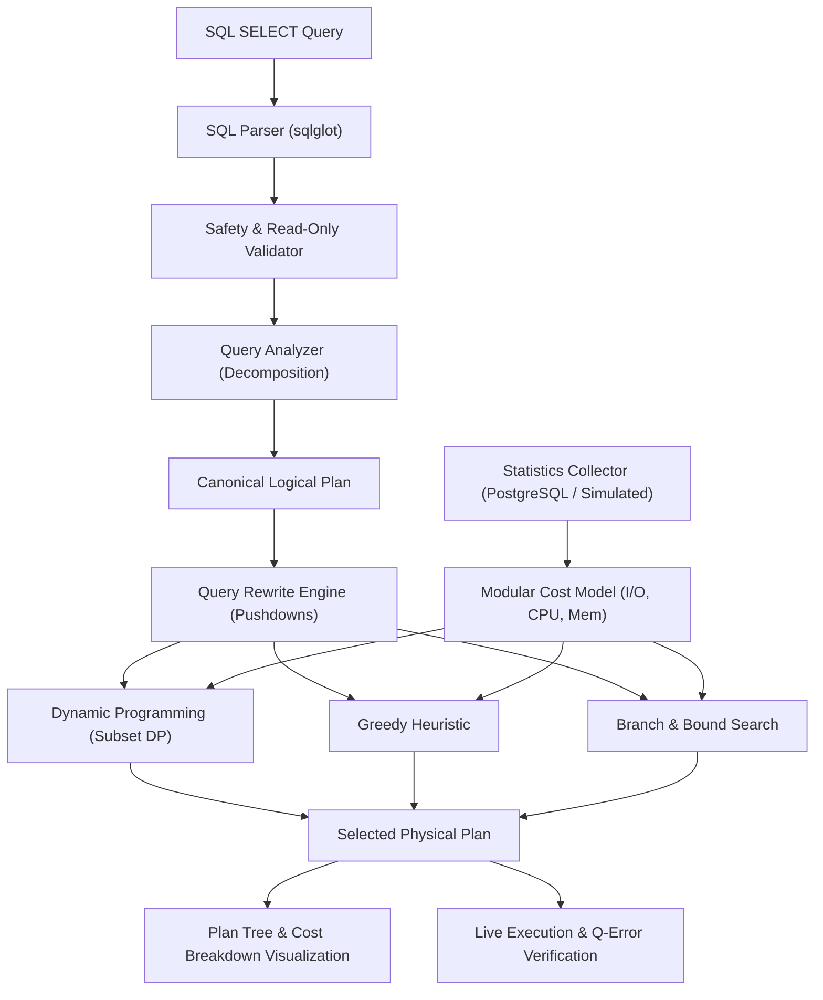

# QueryOptX

<div align="center">

# 🚀 QueryOptX
### Intelligent Database Query Optimization & Execution Plan Analyzer

[](https://fastapi.tiangolo.com)
[](https://react.dev)
[](https://tailwindcss.com)
[](https://www.postgresql.org)
[](#algorithms)
[-brightgreen.svg)](backend/tests)

*An industry-grade database query optimization, cardinality estimation, and execution plan analysis platform powered by **Analysis and Design of Algorithms (AOA)**.*

</div>

---

## 📌 Executive Summary

**QueryOptX** is a complete, production-quality query optimization platform designed to replace black-box database execution with transparent, algorithmically verified query planning. Given an arbitrary SQL `SELECT` query, QueryOptX:

1. Parses SQL into an **Abstract Syntax Tree (AST)** and validates query safety.
2. Generates the canonical **Relational Algebra Logical Query Plan**.
3. Applies **Rule-Based Query Transformations** (Predicate Pushdown, Projection Pushdown, Column Pruning).
4. Extracts database statistics ($N_{\text{distinct}}$, page counts, index availability) from live PostgreSQL or embedded scale catalogs.
5. Employs a **Modular Cost Model** ($C_{\text{I/O}} + C_{\text{CPU}} + C_{\text{Memory}}$) to evaluate access paths (`SeqScan` vs `IndexScan`) and join strategies (`HashJoin`, `Sort-Merge Join`, `NestedLoopJoin`).
6. Executes three real **AOA Optimization Algorithms**:
   * **Dynamic Programming ($O(3^N)$)**: Cost-based subset join enumeration guaranteeing global cost optimality over bushy and left-deep plan spaces.
   * **Greedy Algorithm ($O(N^2)$)**: Heuristic local minimum join ordering baseline.
   * **Branch and Bound**: Permutation space tree search with admissible lower bound pruning.
7. Visualizes the hierarchical execution plan tree, compares algorithms, executes the query safely, and measures estimation accuracy using the **Q-Error** metric.

---

## 🏛️ System Architecture



---

## 🧠 AOA Optimization Algorithms

### 1. Dynamic Programming (Subset DP)
Operates by bottom-up memoization across the lattice of relation subsets $S \subseteq \mathcal{R}$:
$$\begin{aligned}
\text{Base Case } (k=1): & \quad DP[\{R_i\}] = \min(\text{Cost}_{\text{SeqScan}}(R_i), \text{Cost}_{\text{IndexScan}}(R_i)) \\
\text{Recurrence } (k \ge 2): & \quad DP[S] = \min_{\substack{S_1 \subset S \\ S_1 \neq \emptyset, S_2 = S \setminus S_1}} \min_{\text{algo}} \Big( DP[S_1] + DP[S_2] + \text{Cost}_{\text{Join}}(\text{algo}, DP[S_1], DP[S_2]) \Big)
\end{aligned}$$
* **Time Complexity**: $\sum_{k=1}^N \binom{N}{k} (2^k - 2) = 3^N - 2^{N+1} + 1 \in \mathcal{O}(3^N)$
* **Space Complexity**: $\mathcal{O}(2^N)$
* **Optimality**: Provably guarantees global cost optimality over bushy and left-deep search spaces.

### 2. Greedy Optimizer
* Evaluates all pairwise join combinations and greedily picks the locally cheapest choice.
* Iteratively appends remaining candidate relations with minimum immediate join cost.
* **Time Complexity**: $\mathcal{O}(N^2 \cdot |\text{JoinAlgorithms}|)$ — polynomial runtime, but susceptible to local minima.

### 3. Branch and Bound
* State-space tree search maintaining `BestCost` upper bound (seeded by Greedy heuristic).
* **Admissible Lower Bound**: $\text{LowerBound}(P) = \text{CurrentCost}(P) + \sum_{R \in \text{Unjoined}} \text{MinScanCost}(R)$.
* **Pruning Rule**: Prunes search subtree whenever $\text{LowerBound}(P) \ge \text{BestCost}$.

---

## 💻 Tech Stack

* **Frontend**: React 19, TypeScript, Tailwind CSS v4, Lucide Icons, Recharts, Vite.
* **Backend**: Python 3.11+, FastAPI, Pydantic v2, `sqlglot` SQL AST Parser, `asyncpg`, `psycopg2`.
* **Database**: PostgreSQL 16 (with embedded in-memory fallback for instant zero-dependency execution).
* **Testing**: `pytest` (unit, integration, and scaling benchmarks).
* **DevOps**: Docker, Docker Compose.

---

## ⚡ Quick Start

### Prerequisites
* Python 3.10+
* Node.js 18+ (and npm)
* *(Optional)* Docker & Docker Compose

---

### Option A: Running Locally (Recommended for Development)

#### 1. Backend Setup
```bash
cd backend
pip install -r requirements.txt
python -m uvicorn app.main:app --reload --port 8000
```
Backend will be online at: **`http://localhost:8000`**  
Interactive API Docs (Swagger UI): **`http://localhost:8000/docs`**

#### 2. Frontend Setup
```bash
cd frontend
npm install
npm run dev
```
Frontend will be available at: **`http://localhost:5173`**

---

### Option B: Running with Docker Compose
```bash
docker-compose up --build
```
* Frontend: `http://localhost:3000`
* Backend API: `http://localhost:8000`
* PostgreSQL: `localhost:5432`

---

## 🧪 Running the Test Suite

QueryOptX includes 24 comprehensive automated test cases:

```bash
# Run all backend unit, integration, and scaling tests
python -m pytest
```

Test coverage includes:
* `test_parser.py`: SQL safety, mutating SQL rejection, table/join/predicate AST extraction.
* `test_rewriter.py`: Predicate pushdown and projection column pruning.
* `test_cost_model.py`: I/O, CPU, and memory formulas for SeqScan, IndexScan, HashJoin, MergeJoin, NestedLoop.
* `test_cardinality.py`: Selectivity of equality, range, and join cardinality formulas.
* `test_dp_optimizer.py`: Dynamic Programming, Greedy, Branch & Bound, and Comparator validation.
* `test_cache.py`: Parameterized SQL fingerprinting and LRU cache eviction.
* `test_api.py`: FastAPI end-to-end integration tests.
* `test_benchmarks.py`: Scalability tests ($N=2 \dots 5+$ relations) verifying algorithm scaling properties.

---

## 📁 Project Structure

```
aoa project/
├── backend/
│   ├── app/
│   │   ├── api/             # REST Endpoints and route controllers
│   │   ├── benchmark/       # Scalability workloads & benchmark runner
│   │   ├── cache/           # SQL normalizer, fingerprinting & LRU plan cache
│   │   ├── cost/            # Modular I/O, CPU, and memory cost model
│   │   ├── execution/       # PostgreSQL & simulated execution engine + Q-Error
│   │   ├── optimizer/       # DP (O(3^N)), Greedy (O(N^2)), Branch & Bound
│   │   ├── parser/          # sqlglot AST parser & read-only safety validator
│   │   ├── planner/         # Canonical logical & physical plan trees
│   │   ├── rewriter/        # Predicate & projection pushdown transformations
│   │   ├── schemas/         # Pydantic request and response models
│   │   ├── statistics/      # PostgreSQL stats collector & cardinality estimator
│   │   ├── config.py        # Environment settings & cost calibration
│   │   └── main.py          # FastAPI application entrypoint
│   ├── tests/               # 24 comprehensive pytest test suites
│   └── requirements.txt     # Backend dependencies
│
├── frontend/
│   ├── src/
│   │   ├── components/      # UI components (Plan tree, charts, editor, etc.)
│   │   ├── services/        # Backend REST API client
│   │   ├── types/           # TypeScript data interfaces
│   │   ├── App.tsx          # Main Workbench application
│   │   └── main.tsx         # React root
│   ├── package.json
│   └── vite.config.ts
│
├── database/
│   ├── schema.sql           # PostgreSQL schema (University & E-Commerce)
│   ├── seed.sql             # Demonstration seed data
│   └── generate_datasets.py # 10K / 100K / 1M row synthetic generator
│
├── docs/
│   ├── architecture.md      # End-to-end compiler pipeline and decoupling
│   ├── algorithms.md        # DP, Greedy, and Branch & Bound math & proofs
│   ├── cost_model.md        # Detailed costing formulas
│   └── api.md               # REST API specification
│
├── docker-compose.yml       # Multi-container orchestration
├── Dockerfile.backend       # FastAPI container build
├── Dockerfile.frontend      # React production build with Nginx
├── .env.example             # Configuration template
├── pytest.ini               # Pytest configuration
└── README.md
```

---

## 🛡️ Security & Read-Only Enforcement

QueryOptX implements defense-in-depth query execution safety:
1. **Safety Validator**: Regex and AST verification strictly disallows mutating SQL (`DROP`, `DELETE`, `UPDATE`, `INSERT`, `ALTER`, `TRUNCATE`, `EXEC`, `GRANT`).
2. **Read-Only Transaction Guard**: All PostgreSQL execution sessions enforce `SET SESSION CHARACTERISTICS AS TRANSACTION READ ONLY`.
3. **Execution Limits**: Statement timeouts (`5.0s`) and result truncation (`MAX_RESULT_ROWS = 1000`) prevent denial-of-service.

---

## 📜 License

MIT License. Designed for academic and industrial database systems research.
