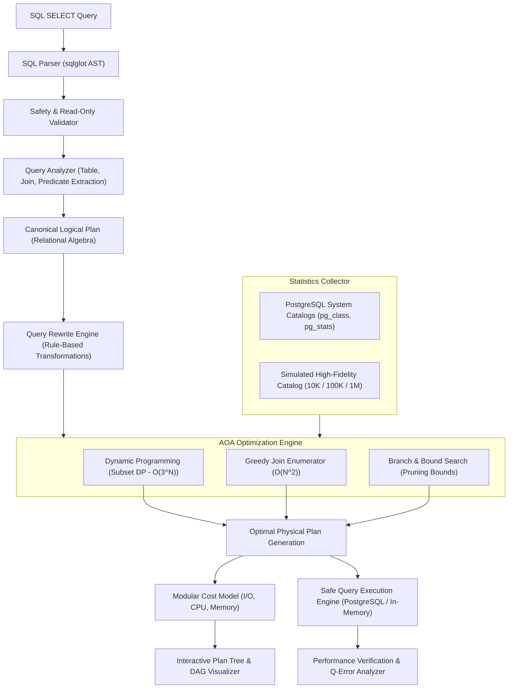

# QueryOptX System Architecture

## Intelligent Database Query Optimization & Execution Plan Analyzer

---

### 1. Executive Summary & Design Paradigm

**QueryOptX** is a production-grade query plan optimization, cardinality estimation, and execution analysis platform designed for database systems engineering. Rather than treating SQL queries as opaque strings executed by a black-box database engine, QueryOptX exposes the end-to-end compiler pipeline and applies fundamental **Analysis and Design of Algorithms (AOA)** techniques (Dynamic Programming, Greedy Heuristics, Branch & Bound search) to search the exponential relational join space.

---

### 2. End-to-End Compiler Pipeline

---

### 3. Pipeline Stages & Architectural Decoupling

#### 3.1 SQL Parsing & Abstract Syntax Tree (AST)
* **Parser Engine**: Uses `sqlglot` to produce an unambiguous AST for SQL `SELECT` statements.
* **Safety Validator**: Rejects multi-statement attacks and mutating SQL operations (`DROP`, `DELETE`, `UPDATE`, `INSERT`, `ALTER`, `TRUNCATE`, `EXEC`) to ensure strictly read-only execution.
* **Normalized Internal Model**: Deconstructs the AST into structured relational representations:
  * Table References & Aliases
  * Equi-Join & Non-Equi Join Conditions
  * Single-Table Filter Expressions
  * Projection Attributes & Aggregate Functions (`COUNT`, `SUM`, `AVG`, `MIN`, `MAX`)
  * Grouping and Sorting Orders

#### 3.2 Canonical Logical Plan Generation
Constructs an initial canonical Relational Algebra tree:
$$\text{Projection} \rightarrow \text{Sort} \rightarrow \text{Aggregate} \rightarrow \text{Selection} \rightarrow \text{JoinTree} \rightarrow \text{Scans}$$

#### 3.3 Rule-Based Query Rewrite Engine
Transforms the canonical tree using semantics-preserving algebraic rewrite rules:
1. **Predicate Pushdown**: Pushes selection predicates $\sigma_p$ past joins down to the base table scan operators, minimizing intermediate cardinality early.
2. **Projection Pushdown & Column Pruning**: Prunes unused attributes from intermediate record materialization to minimize memory footprint and buffer overhead.
3. **Join Commutativity & Associativity Exploration**: Identifies equivalent join shapes:
   $$A \bowtie B \equiv B \bowtie A$$
   $$(A \bowtie B) \bowtie C \equiv A \bowtie (B \bowtie C)$$
4. **Provenance Tracking**: Records detailed before/after explanations of applied transformations for UI inspection.

#### 3.4 Database Statistics & Cardinality Estimator
* **Live Catalog Introspection**: Queries PostgreSQL `pg_class`, `pg_stats`, and `pg_indexes` for live table sizes, page counts, distinct values ($N_{\text{distinct}}$), and index coverage.
* **Resilient Embedded Catalog**: Pre-populated with realistic schemas for academic university (10K–1M scale) and e-commerce retail data.
* **Statistical Estimator**: Computes selectivity factors:
  * Equality: $s = \frac{1}{N_{\text{distinct}}}$
  * Range: Linear interpolation on min/max bounds
  * Join Cardinality: $\text{Card}(R \bowtie S) = \frac{|R| \times |S|}{\max(V(R, A), V(S, B))}$

#### 3.5 Physical Plan Generator & Modular Cost Model
Translates logical operators into concrete physical execution algorithms:
* **Access Paths**: `SeqScan`, `IndexScan`
* **Join Strategies**: `HashJoin`, `Sort-Merge Join`, `NestedLoopJoin`
* **Post-Processing**: `HashAggregate`, `ExternalSort`, `ResultProjection`

Costing formula evaluates:
$$\text{Total Cost} = \text{Disk I/O Cost} + \text{CPU Processing Cost} + \text{Memory Buffer Cost}$$

#### 3.6 Plan Cache & Query Fingerprinting
* Normalizes literal constants in SQL statements into structural templates (`?`).
* Computes deterministic SHA-256 fingerprints.
* Stores plans in an in-memory LRU Cache with hit/miss telemetry.

#### 3.7 Execution & Verification Engine
* Executes queries against live PostgreSQL or embedded SQLite fallback with statement timeouts and maximum row limits.
* Computes execution accuracy using the **Q-Error** metric:
  $$\text{Q-Error} = \max\left(\frac{\text{Estimated Rows}}{\text{Actual Rows}}, \frac{\text{Actual Rows}}{\text{Estimated Rows}}\right)$$
